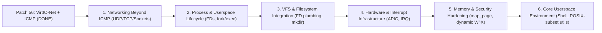

# NOXISA — Complete Project State & Roadmap
**Session-continuity document, consolidated through Patch 56 (VirtIO-Net → smoltcp → ICMP Ping)**  
*Authoritative project reference — supersedes all prior revisions.*

---

## Executive Summary: What is Noxisa Today?

### 1. What Noxisa Is Today
Noxisa is a solo-built, 64-bit x86 (`x86_64`) operating system kernel written in Rust (`no_std`), booted via the Limine bootloader under UEFI. It runs on both bare-metal hardware (Dell Inspiron 5502) and virtualized environments (QEMU `q35`). It features:
* **Custom Architecture**: Standalone physical memory manager (PMM), HHDM-backed heap allocator, page tables with manual PML4 translation, GDT/IDT/TSS, CPU exception handling, and naked-assembly syscall handlers (`sys_write`, `sys_exit`, `sys_draw`).
* **Security & Isolation First**: Ring 3 userspace execution, per-process page tables, W^X enforcement, guard pages, capability bitmasks (`CAP_WRITE_SERIAL`, `CAP_DRAW`), owner/group/other VFS permission enforcement, default-deny IPC, memory scrubbing on deallocation, audit logging, and preemptive scheduling.
* **Hardware Abstraction Layer (HAL)**: Trait-based registry providing uniform interfaces for `Console`, `InputDevice`, `DisplayDevice`, `BlockDevice`, and `NetworkDevice`.
* **NVMe Storage & ext2 Filesystem**: Full NVMe controller driver with admin/IO submission and completion queues, GPT partition table parsing with CRC32 validation, and a complete read-write ext2 filesystem driver supporting multi-level path resolution, direct and singly-indirect block allocation, file/directory creation, growth, overwrite, and deletion, audited for crash-safety ordering.
* **Network Stack (Patch 56 Complete)**: VirtIO-Net modern PCI device driver with split virtqueues, HAL network registry integration, smoltcp 0.14.0 network stack, and working ARP/IPv4/ICMP echo response over QEMU user networking.

### 2. What Has Actually Been Proven
Every claim in this document is separated into **proven on real hardware (Dell Inspiron 5502) + QEMU** or **proven in QEMU**:
* **Proven on Dell + QEMU**: Core boot, PMM, heap, paging, GDT/IDT, syscalls, Ring 3 execution, preemptive scheduling, per-process page tables, W^X, memory scrubbing, audit logging, HAL (console, display, input), and NVMe read/write discovery.
* **Proven in QEMU (Standing Safety Rule)**: GPT CRC32 validation, complete ext2 write-support arc (file/dir create, grow, write, delete, indirect blocks, crash-safety ordering), and the complete Patch 56 network stack (`pcitest`, `pingtest` with 0 ms round-trip to `10.0.2.2`).

### 3. What Core Pieces Remain Before Noxisa Reaches Its Intended Usable OS Milestone
Before Noxisa can be considered a self-contained, usable operating system, six core functional areas remain to be completed:
1. **Networking beyond ICMP**: UDP, TCP, socket abstractions, socket syscalls, userspace networking, and basic DNS/DHCP.
2. **Process & Userspace Completion**: Full per-process address-space lifecycle (fork/exec/wait/exit), standard file descriptor tables (`stdin`, `stdout`, `stderr`, open files), and syscall ABI stabilization.
3. **Memory & Security Hardening**: Dynamic `map_page` implementation, complete kernel guard pages/NX enforcement, and capability enforcement over syscalls.
4. **Hardware & System**: APIC/IOAPIC interrupt routing (transitioning from polling to interrupt-driven completion where appropriate), ACPI shutdown/power management, and timer improvements.
5. **VFS & Filesystem Robustness**: File descriptor integration with VFS, directory creation (`mkdir`), standard file modes, and clean unmount/sync.
6. **Userspace Environment**: Interactive user-mode shell, basic core utilities (`cat`, `ls`, `echo`, `rm`), and a functional C/Rust runtime environment.

### 4. What is Optional Afterward
Features explicitly deferred and non-blocking for the core OS milestone:
* Desktop environment, Wayland-style compositor, and window styling.
* Wisdom AI / LLM system daemon.
* Web browser and graphical application suites.
* Extended device drivers (Wi-Fi, Bluetooth, Audio, USB xHCI).
* Containerization, hypervisor/virtualization, and secondary CPU architectures (ARM64/RISC-V).

---

## PART 1 — Verified Ground Truth (Current Project State)

### 1.1 Core Kernel & CPU (Proven QEMU + Dell)
* **Boot Protocol**: Limine native protocol, higher-half kernel mapping (`0xFFFF_8000_0000_0000`), base revision 3 supported.
* **Physical Memory Manager (PMM)**: Hybrid LIFO free-list and bump allocator managing usable memory across 32 E820/Limine memory map entries. Frames are scrubbed (zeroed) on free.
* **Kernel Heap**: `linked_list_allocator::LockedHeap` mapped in higher-half memory, hardened with redzone canaries and zero-on-free validation.
* **Virtual Memory / Paging**: 4-level PML4 paging. Manual table walks, Higher Half Direct Map (HHDM) translation via `phys_to_virt()` and `virt_to_phys()`, and `map_mmio()` for caching-disabled, non-executable MMIO mappings.
* **Descriptor Tables**: GDT with 64-bit kernel code/data segments, user code/data segments, and Task State Segment (TSS) with dedicated double-fault interrupt stack (`IST1`) and ring-0 stack pointer (`RSP0`). IDT with dedicated exception gates (#DE, #DB, #BP, #OF, #UD, #GP, #PF, #DF).
* **Preemptive Scheduler**: Tick-driven context switcher utilizing PIT/APIC interrupts, managing cooperative and preemptive task execution, clean thread termination, and resource reaping.
* **Syscall Architecture**: MSR-based `syscall`/`sysret` configuration (STAR, LSTAR, SFMASK, EFER). Naked assembly trampoline handling user-to-kernel register preservation.

### 1.2 Isolation & Security Model (Proven QEMU + Dell)
* **Isolated Address Spaces**: Per-process PML4 page tables isolating user processes from peer processes and unmapping user pages in kernel space.
* **W^X Enforcement**: Code pages marked read-only executable; data/heap/stack pages marked readable, writable, no-execute (NX).
* **Capabilities**: Capability bitmask (`CAP_WRITE_SERIAL`, `CAP_DRAW`) verified at syscall boundaries.
* **IPC Isolation**: Explicit-policy, default-deny IPC ring buffers between registered endpoints.
* **Audit Subsystem**: Kernel-level audit ring buffer logging security-sensitive events (privilege checks, capability failures, isolation faults).

### 1.3 Hardware Abstraction Layer (HAL) (Proven QEMU + Dell)
Unified device registry (`hal/registry.rs`) backed by zero-sized driver adapter types implementing domain traits:
* `Console`: `write_fmt()` dispatched to 16550 UART serial driver.
* `InputDevice`: `poll_char()` dispatched to PS/2 keyboard controller.
* `DisplayDevice`: `dimensions()`, `fill_rect()`, `set_pixel()` dispatched to Limine linear framebuffer driver.
* `BlockDevice`: `block_size()`, `block_count()`, `read_block()`, `write_block()` dispatched to NVMe driver.
* `NetworkDevice`: `send()`, `receive()`, `mac_address()` dispatched to VirtIO-Net driver (added Patch 56).

### 1.4 NVMe Storage & ext2 Filesystem (Proven QEMU; Read Proven Dell)
* **NVMe Driver**: PCI configuration, BAR0 MMIO mapping, admin submission/completion queues, IO submission/completion queues, polled command completions, LBA-addressed block operations.
* **Partition Table**: GPT parsing with partition UUID lookup, LBA boundaries, and real CRC32 header and partition-array validation.
* **ext2 Read Support**: Superblock, block group descriptors, inode allocation bitmaps, direct block indexing, singly-indirect block reading, multi-level directory traversal (`/a/b/c`), and boot-time VFS root mount.
* **ext2 Write Support (Patches 48–55)**:
  * In-place block overwrite.
  * Direct block allocation via block bitmap scanning.
  * Inode allocation and directory entry insertion reusing record length (`rec_len`) slack.
  * File deletion with block bitmap deallocation, inode deallocation, and directory slot compaction.
  * Singly-indirect block allocation for files exceeding 12 KiB (up to block limit).
  * Directory growth with dynamic block allocation when directory slack is exhausted.
  * Directory deletion (`rmdir`) removing empty directories with parent link-count and used-directory updates.
  * **Crash-Safety Ordering Audit (Patch 55)**: All disk modifications ordered so an abrupt power loss can only leak blocks/inodes, never leave dangling directory entries or expose uninitialized data blocks.

---

## PART 2 — Patch 56: VirtIO-Net, smoltcp, and ICMP Ping (COMPLETE)

### 2.1 Scope & Architecture
Patch 56 integrates a complete, end-to-end network stack into Noxisa, establishing the foundation for all future network services:

```text
+-------------------------------------------------------------+
|                      kshell: pingtest                       |
+-------------------------------------------------------------+
                              |
+-------------------------------------------------------------+
|               smoltcp 0.14.0 Network Stack                  |
|    (Interface, SocketSet, ICMPv4, IPv4, ARP, Ethernet)      |
+-------------------------------------------------------------+
                              |
+-------------------------------------------------------------+
|                net::HalNetDevice (Device GAT)               |
+-------------------------------------------------------------+
                              |
+-------------------------------------------------------------+
|            hal::registry (net_send / net_receive)           |
+-------------------------------------------------------------+
                              |
+-------------------------------------------------------------+
|           hal::net::VirtIONetDevice (NetworkDevice)         |
+-------------------------------------------------------------+
                              |
+-------------------------------------------------------------+
|     drivers::virtio_net (Split Virtqueues, Modern PCI MMIO) |
+-------------------------------------------------------------+
                              |
+-------------------------------------------------------------+
|            QEMU virtio-net-pci (slirp user network)         |
+-------------------------------------------------------------+
```

### 2.2 Verified Implementation Facts
* **PCI Configuration Space Writes**: Implemented `config_write_u16()` and `config_write_u32()` in `drivers/pci.rs` via legacy I/O ports `0xCF8`/`0xCFC`.
* **PCI Capability List Walker**: Implemented `walk_capabilities()` traversing the PCI capability linked list starting from config offset `0x34`.
* **VirtIO-Net Device Discovery**: Implemented `find_virtio_net()` matching vendor `0x1AF4` and device IDs `0x1000` through `0x1041` with subsystem ID `0x01`.
* **VirtIO PCI Modern Transport**: Implemented parsing for `VIRTIO_PCI_CAP_COMMON_CFG`, `VIRTIO_PCI_CAP_NOTIFY_CFG`, `VIRTIO_PCI_CAP_ISR_CFG`, and `VIRTIO_PCI_CAP_DEVICE_CFG`. BAR memory regions mapped using non-cacheable MMIO page mappings (`paging::map_mmio`).
* **VirtIO Split Virtqueues**: Implemented split virtqueue management (`VirtQueue`) containing descriptor tables, available rings, and used rings. Allocated physically contiguous memory using `memory::pmm::alloc_contiguous_frames()`.
* **VirtIO-Net Initialization & Lifecycle**: Standard VirtIO 1.0 reset sequence implemented: Reset (`status = 0`) → Acknowledge (`ACKNOWLEDGE`) → Driver (`DRIVER`) → Feature Negotiation → Driver Ready (`DRIVER_OK`).
* **MAC Address Detection**: Real MAC address read from device-specific configuration space (`52:54:00:12:34:56`).
* **Packet Transmission (TX)**: Polled transmission model matching NVMe architecture. Descriptor populated with VirtIO net header and Ethernet payload, notified via queue notify doorbells, and polled on the used ring.
* **Packet Reception (RX)**: Pre-posted RX buffers to virtqueue; polled on arrival, data extracted, and buffer immediately replenished to maintain reception flow.
* **HAL Network Layer**: Created `hal/net.rs` defining the `NetworkDevice` trait (`send`, `receive`, `mac_address`). Added `NET` singleton slot and global dispatchers (`net_send`, `net_receive`, `net_mac_address`) to `hal/registry.rs`.
* **smoltcp 0.14.0 Integration**: Integrated smoltcp as a `no_std` path dependency (`noxisa-networking-reference/smoltcp`) with features `medium-ethernet`, `proto-ipv4`, `socket-icmp`, and `alloc`. Implemented smoltcp's GAT-based `Device`, `RxToken`, and `TxToken` traits in `net.rs`.
* **Network Configuration**: Configured interface with static IPv4 address `10.0.2.15/24` and default route via gateway `10.0.2.2`.
* **Third-Party Code Licensing**:
  * VirtIO driver algorithms adapted from `virtio-drivers` with MIT license notice explicitly preserved in `drivers/virtio_net.rs`.
  * smoltcp 0.14.0 licensed under 0BSD (permissive, zero-clause).
* **Build & Packaging**: Built kernel binary (`target/x86_64-unknown-none/release/nexus-kernel`) with 0 errors. Created 4.0 MB bootable UEFI ISO (`nexus.iso`).

### 2.3 Runtime Verification Proof
QEMU launched with:
```bash
qemu-system-x86_64 -M q35 -m 512M \
  -drive if=pflash,format=raw,readonly=on,file=/usr/share/edk2/x64/OVMF_CODE.4m.fd \
  -drive if=pflash,format=raw,file=OVMF_VARS.local.fd \
  -cdrom nexus.iso \
  -device nvme,drive=nvmedrive,serial=deadbeef \
  -drive if=none,id=nvmedrive,format=raw,file=nvme-test.img \
  -netdev user,id=net0 \
  -device virtio-net-pci,netdev=net0 \
  -serial stdio -display none -no-reboot -no-shutdown
```

#### Kernel Boot Log
```text
[boot] HAL ready - console/input/display/block/net registered
[boot] Init VirtIO-Net...
[virtio-net] Found VirtIO-Net: bus=0 dev=3 func=0 vendor=0x1af4 device=0x1000
[virtio-net] MMIO mapped: common=0xffff80c000000000 notify=0xffff80c000003000 isr=0xffff80c000001000 devcfg=0xffff80c000002000
[virtio-net] Device features: 0x0000010130bf8024
[virtio-net] MAC: 52:54:00:12:34:56
[virtio-net] RX max queue size: 256
[virtio-net] TX max queue size: 256
[virtio-net] Device initialised, DRIVER_OK set
[boot] Init smoltcp network stack...
[net] Initialised: IP 10.0.2.15/24, MAC 52:54:00:12:34:56
[vfs] Mounting root filesystem
[vfs] Mounting ext2 at /
[vfs] Root filesystem (ext2) mounted at / from LBA 2048
[boot] Handing off to scheduler - kshell starts now (native)...

Noxisa kernel shell — type 'help'
Nexus>
```

#### PCI Bus Scan (`pcitest`)
```text
Nexus> pcitest
--- PCI enumeration test ---
[pci] 00:00.0 vendor=8086 device=29c0 class=06 subclass=00 prog_if=00
[pci] 00:01.0 vendor=1234 device=1111 class=03 subclass=00 prog_if=00
[pci] 00:02.0 vendor=1b36 device=0010 class=01 subclass=08 prog_if=02
[pci] 00:03.0 vendor=1af4 device=1000 class=02 subclass=00 prog_if=00
[pci] 00:1f.0 vendor=8086 device=2918 class=06 subclass=01 prog_if=00
[pci] 00:1f.2 vendor=8086 device=2922 class=01 subclass=06 prog_if=01
[pci] 00:1f.3 vendor=8086 device=2930 class=0c subclass=05 prog_if=00
[pcitest] 7 device(s) found via config-space enumeration
[pcitest] NVMe controller found at 00:02.0 (vendor=1b36 device=0010)
[pcitest] BAR0: base=0xc000004000 mmio=true 64bit=true prefetchable=false
[pcitest] PASS - NVMe controller and BAR0 discovered
```

#### ICMP Ping Test (`pingtest`)
```text
Nexus> pingtest
--- pingtest: ICMP Echo Request to 10.0.2.2 ---
Sending ICMP Echo Request to 10.0.2.2 (ident=0x22b, seq=1)...
Reply from 10.0.2.2: seq=1, len=12 bytes, time=0 ms
pingtest: PASS
```

#### Regression Suite Verification
All existing subsystems verified functional with zero regressions:
```text
Nexus> haltest
[haltest] Proving hal::registry wrappers are genuine pass-throughs, not just structure
[haltest] via hal::registry::console_write_fmt
[haltest] via drivers::serial::write_fmt directly
[haltest] hal::registry::display_dimensions() = Some((1280, 800))
[haltest] drivers::gpu::dimensions() direct  = (1280, 800)
[haltest] hal::registry::display_fill_rect(...) returned true
[haltest] hal::registry::input_poll_char() = None (no keypress expected; None is a PASS here)
[haltest] PASS - console, display, and input all reached the real drivers through the HAL registry, dimensions matched exactly

Nexus> blockdevtest
--- BlockDevice HAL abstraction test (write/read/compare through the registry only) ---
[blockdevtest] hal::registry::block_size()  = 512 bytes
[blockdevtest] hal::registry::block_count() = 131072 blocks
[blockdevtest] writing pattern to LBA 0 via hal::registry::block_write()
[blockdevtest] block_write PASS
[blockdevtest] block_read PASS
[blockdevtest] memcmp PASS - 512 bytes match exactly
[blockdevtest] PASS - BlockDevice HAL abstraction is a genuine pass-through

Nexus> ext2test
--- ext2 filesystem test (superblock, root dir, file read - via BlockDevice HAL) ---
[ext2test] using partition 0: LBA 2048..=131038
[ext2test] superblock OK - magic=0xef53 block_size=1024 inodes_count=16128 blocks_count=64492 inode_size=256
[ext2test] root directory: 11 entries
[ext2test] read hello.txt: 21 bytes
[ext2test] memcmp PASS - contents match exactly
[ext2test] PASS - superblock, directory listing, and file read all verified
```

---

## PART 3 — Current kshell Command Reference
All 38 test and utility commands active in `kshell` (defined in `main.rs`):

| Command | Category | Verification Target |
|---------|----------|---------------------|
| `help` | Shell | Prints available command list |
| `meminfo` | System | Free PMM frames and MiB |
| `version` | System | Kernel release and build identifier |
| `reboot` | System | ACPI / 8042 keyboard controller reset |
| `ticks` | Timer | Current PIT timer ticks |
| `uptime` | Timer | Milliseconds elapsed since boot |
| `syscalls` | Syscall | Raw `sys_write` and `sys_exit` execution |
| `scrubtest` | Memory | Verifies freed memory frames are zeroed |
| `teardowntest` | Memory | Process termination and frame reclamation |
| `multitest` | Scheduler | Multi-process concurrent scheduling |
| `audittest` | Security | Audit ring buffer event logging |
| `heaptest` | Memory | Heap allocation canary corruption detection |
| `isotest` | Isolation | Ring-3 memory isolation boundary |
| `isofault` | Isolation | Page fault on unauthorized memory access |
| `wxtest` | Security | W^X violation prevention |
| `guardtest` | Security | Guard page allocation trap |
| `captest` | Security | Capability check enforcement |
| `permtest` | Security | VFS permissions (owner/group/other) |
| `ipctest` | IPC | Default-deny message queue IPC |
| `spawn` | Process | Ring-3 user process spawning |
| `restest` | Security | Resource limits enforcement |
| `conctest` | Scheduler | High-concurrency task scheduling |
| `preempttest` | Scheduler | Non-yielding task preemption by timer |
| `drawtest` | Display | Capability-gated `sys_draw` syscall |
| `ownertest` | Security | File ownership validation |
| `haltest` | HAL | Registry dispatch for console, display, input |
| `pcitest` | Driver | PCI bus device enumeration (NVMe + VirtIO) |
| `mmiotest` | Memory | MMIO page table mapping attributes |
| `nvmeinittest` | Storage | NVMe controller initialization |
| `identifytest` | Storage | NVMe namespace identification |
| `nvmeiotest` | Storage | Raw NVMe LBA read and write |
| `blockdevtest` | HAL | BlockDevice HAL trait write/read pass-through |
| `gpttest` | Storage | GPT partition parsing and CRC32 verification |
| `ext2test` | Filesystem | Superblock, directory listing, and file read |
| `ext2mounttest`| Filesystem | ext2 VFS mount verification |
| `roottest` | Filesystem | Automatic boot-time root mount verification |
| `ext2pathtest` | Filesystem | Multi-level directory path resolution (`/a/b/c`) |
| `ext2indirecttest` | Filesystem | Singly-indirect block reading (> 12 KiB) |
| `ext2writetest` | Filesystem | In-place file block overwrite |
| `ext2growtest` | Filesystem | Direct block allocation file growth |
| `ext2createtest` | Filesystem | Inode allocation and directory entry creation |
| `ext2deletetest` | Filesystem | File deletion and directory slot reuse |
| `ext2indirectgrowtest` | Filesystem | Indirect block allocation file growth |
| `ext2dirgrowtest` | Filesystem | Directory block allocation on overflow |
| `ext2rmdirtest` | Filesystem | Directory removal and link-count tracking |
| `pingtest` | Network | ICMP Echo Request to `10.0.2.2` via smoltcp (Patch 56) |

---

## PART 4 — Remaining Core Roadmap

To keep development bounded and maintain engineering integrity, work is strictly prioritized into **Remaining Core OS Milestones** required for a minimal usable operating system. Arbitrary speculative patch numbers are omitted.



### 1. Networking Beyond ICMP
* **UDP Socket Support**:
  * Enable smoltcp `socket-udp` feature.
  * Implement UDP socket buffers and endpoints in kernel net subsystem.
  * Add kshell `udptest` verifying packet transmission and reception.
* **TCP Socket Support**:
  * Enable smoltcp `socket-tcp` feature.
  * Implement active connect (three-way handshake) and passive listen state machines.
  * Add kshell `tcptest` verifying connection establishment with a host service.
* **Socket Abstraction Layer**:
  * Define generic `Socket` trait inside kernel network layer.
  * Implement buffer management and polling interfaces.
* **Socket Syscalls**:
  * Introduce standard network syscall numbers: `sys_socket`, `sys_bind`, `sys_connect`, `sys_send`, `sys_recv`, `sys_close`.
  * Gate network syscall access behind a dedicated capability (`CAP_NET`).
* **Userspace Networking**:
  * Provide network access to Ring 3 binaries via the syscall interface.
* **Network Configuration (DNS/DHCP)**:
  * Integrate DHCP client protocol to replace hardcoded `10.0.2.15` static configuration.
  * Basic DNS resolver mapping hostnames to IPv4 addresses.

### 2. Process & Userspace Lifecycle Completion
* **Per-Process Address-Space Completion**:
  * Dynamic user heap (`sys_brk` or `sys_mmap`) allowing variable-size memory allocation for user processes.
  * Per-process user stack allocation with guard page protection.
* **Process Lifecycle Primitives**:
  * `sys_fork` (or lightweight process clone) duplicating page tables with copy-on-write or separate frame allocation.
  * `sys_execve` replacing process image with an ELF binary read from ext2.
  * `sys_waitpid` and process exit code signaling.
* **File Descriptor Table (FDT)**:
  * Per-process array mapping integer file descriptors to open VFS node handles.
  * Standard stream bindings (`0 = stdin`, `1 = stdout`, `2 = stderr`).
* **Userspace ABI Refinement**:
  * Standardized register calling convention for 64-bit syscalls (`rdi`, `rsi`, `rdx`, `r10`, `r8`, `r9` / return in `rax`).
  * Structured error reporting (negative `errno` standard).

### 3. VFS & Filesystem Completion
* **File Descriptor Plumbing**:
  * Connect `sys_open`, `sys_read`, `sys_write`, `sys_close`, `sys_lseek` directly to VFS inodes via the process FDT.
* **Directory Creation (`mkdir`)**:
  * Implement directory inode allocation and initialization with `.` and `..` entries in ext2.
* **Permissions & Attributes**:
  * Wire VFS permission checks to the caller's process credentials (`uid`, `gid`).
  * Implement `sys_stat` returning file size, mode, inode number, and timestamps.
* **ext2 Robustness**:
  * Flush/sync primitives ensuring dirty metadata blocks and bitmaps commit to storage.
  * Clean unmount operations updating superblock clean state.

### 4. Hardware & System Infrastructure
* **Interrupt Routing (APIC / IOAPIC)**:
  * Complete LAPIC and IOAPIC configuration in `drivers/apic.rs`.
  * Route PCI interrupts (NVMe, VirtIO) to dedicated interrupt vectors.
  * Transition driver completions from polling loops to interrupt-driven event notifications with wait queues.
* **SMP / Multicore**:
  * APIC-based Application Processor (AP) startup sequence.
  * Per-CPU run queues and scheduler lock refinement.
* **ACPI & System Power**:
  * Basic ACPI table parsing (RSDP, MADT, FADT).
  * Clean ACPI system shutdown and power-off.

### 5. Memory & Security Hardening
* **Dynamic Page Mapping (`map_page`)**:
  * Replace the `map_page()` stub in `memory/paging.rs` with functional multi-level page table allocation.
  * Enable functional kernel guard pages and dynamic NX enforcement via `memory_hardening.rs`.
* **Capability Hardening**:
  * Fine-grained capability bitmask checks enforced unconditionally across all syscall handlers.
* **Fault Handling & Resource Limits**:
  * Robust user-mode page fault handling (terminating offending process without kernel panic).
  * Enforcement of maximum frame, CPU time, and file descriptor limits per process.

### 6. Core Userspace Environment
* **Interactive User Shell**:
  * Move shell execution from kernel space (`kshell`) to an independent Ring 3 binary reading from standard input and writing to standard output.
* **Essential Core Utilities**:
  * Self-contained Ring 3 utility binaries: `cat`, `ls`, `echo`, `rm`, `mkdir`, `ping`.
* **C / Rust Minimal Runtime**:
  * Lightweight C runtime library (e.g., `nolibc` port) or bare-metal Rust user-mode runtime supporting standard syscall bindings.

---

## PART 5 — Optional & Future Features (Post-Milestone)

These items are deliberately placed outside the critical path of the core OS milestone. They will not be addressed until the Remaining Core Roadmap is fully delivered:
* **Desktop Environment & GUI**:
  * Real user-space Wayland-compatible display server / compositor.
  * Window management, cursor input, fonts, and graphical UI framework.
* **AI Subsystem ("Wisdom AI")**:
  * User-space inference service communicating over sandboxed IPC ring buffers.
  * Shell assistant integrations (optional, zero telemetry, local-first).
* **Extended Peripheral Drivers**:
  * USB stack (xHCI controller, HID, mass storage).
  * Audio subsystems (Intel HDA / VirtIO-Sound).
  * Wi-Fi and Bluetooth wireless stacks.
* **Compatibility Layers**:
  * Expanded Linux compatibility layer (gVisor or WSL-style syscall translation).
* **Advanced Virtualization**:
  * KVM-like hypervisor capabilities and container runtimes.
* **Architecture Ports**:
  * 64-bit ARM (`aarch64`) and RISC-V (`riscv64`) platform bring-up.

---

## PART 6 — Cumulative Patch Index (1–56)

| Range | Subsystem | Key Accomplishments |
|---|---|---|
| **Patches 1–22** | Core Kernel & Security | Limine boot, PMM, HHDM heap, GDT/IDT, syscalls, Ring 3, preemptive scheduler, per-process page tables, W^X, capabilities, IPC, memory scrub, audit log. |
| **Patches 23–32** | HAL Phase A | Console, InputDevice, DisplayDevice trait definitions and registry; scheduler preemption race fix. |
| **Patches 33–38** | HAL Phase B.1 | PCI bus scanning, NVMe controller init, admin/IO queue lifecycle, 64-bit MMIO BAR0 mapping, BlockDevice HAL abstraction. |
| **Patches 41–44** | HAL Phase C | GPT partition table parsing, ext2 superblock parsing, read-only directory traversal, automatic boot-time root mount (`mount_root()`). |
| **Patches 45–47** | ext2 Read Enhancements | Multi-level path resolution (`/a/b/c`), singly-indirect block reading (> 12 KiB files), GPT CRC32 validation. |
| **Patches 48–51** | ext2 Write Foundation | In-place block overwrite, direct block allocation via bitmap scan, real file creation with `rec_len` slack reuse, real file deletion with slot compaction. |
| **Patches 52–55** | ext2 Advanced Write & Safety | Singly-indirect block allocation, directory block growth, directory deletion (`rmdir`), and comprehensive crash-safety ordering audit. |
| **Patch 56** | **Networking Foundation** | **PCI config writes/capabilities, VirtIO-Net modern PCI driver, split virtqueues, HAL NetworkDevice registry, smoltcp 0.14.0 integration, ARP/IPv4/ICMP ping (`pingtest: PASS`).** |

---

## PART 7 — Documentation Integrity & Standing Rules

1. **Ground Truth Rule**: Part 1 and Part 2 record strictly verified facts proven by compiler output and QEMU/Dell execution logs. Never mark an item DONE based on plans or code that hasn't executed.
2. **Standing Hardware Safety Rule (Part 19.2)**: Never execute real block-device write tests against a bare-metal machine's internal non-volatile boot drive. Disk write testing must always use disposable backing images in QEMU or dedicated external drives.
3. **Single Authoritative Document**: Per Part 7 of the original project charter, this document acts as the single source of truth for project state and roadmap. Parallel speculative roadmaps must not be created.
